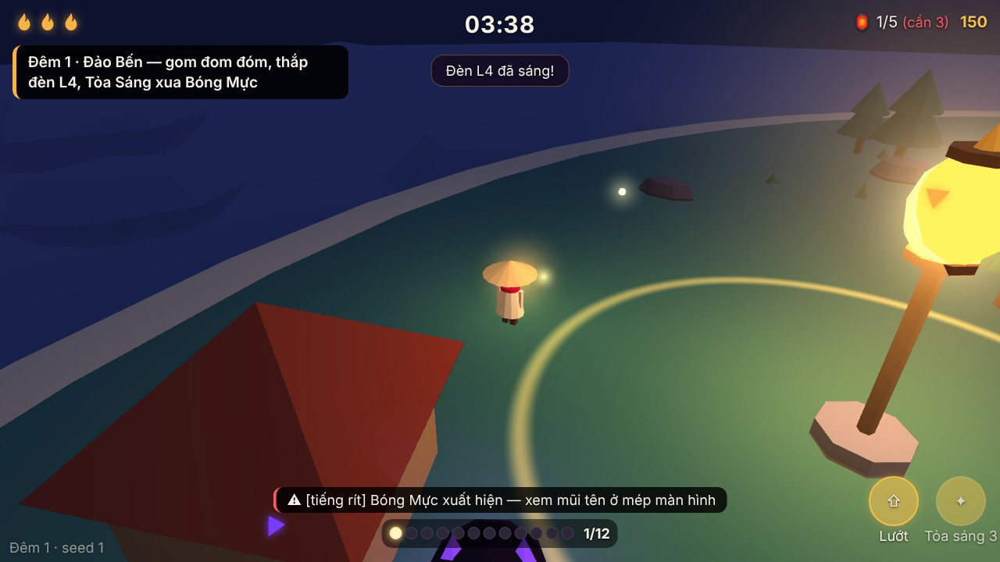

# Đảo Đèn Lồng · v1.0.0

> 🎬 **Video demo (dưới 5 phút):** [docs/demo/demo.mp4](docs/demo/demo.mp4). Video cũng được đính kèm ở [Release v1.0.0](https://github.com/Long1806T/K5-L3A-DAY12-PHAMNHULONG-2A202603395-AI-SDLC/releases/tag/v1.0.0).

Game 3D góc nhìn thứ ba, gồm **3 Đêm**: Đảo Bến, Đảo Cau, Đảo Chuông. **Mây** là người giữ đèn nhỏ tuổi, mặc áo kem, quàng khăn
đỏ, đội nón lá có treo đèn lồng. Mây gom đom đóm để thắp và **giữ cho các Đèn Lồng Lớn còn dầu** tới bình minh. Trên đường
đi, Mây phải né **Bóng Mực** tím đen và giữ đom đóm khỏi tay **Gió Lạc**.

Game viết bằng JavaScript thuần. Phần logic tất định dùng chung cho trình duyệt và chế độ headless. Renderer WebGL tự viết,
âm thanh tổng hợp bằng WebAudio. **Không dùng thư viện ngoài, không tải asset nào về.**



## Yêu cầu hệ thống

| | Tối thiểu |
|---|---|
| Hệ điều hành | Windows 10/11, macOS 12+ hoặc Linux |
| Node.js | ≥ 18 (khuyên dùng 22 LTS). Không cần `npm install`: dự án không có dependency |
| Trình duyệt | Có WebGL: Chrome hoặc Edge (khuyên dùng), Firefox, Safari |
| Benchmark | Cần Chrome, Edge hoặc Chromium đã cài (`tools/bench.js` tự tìm; có thể chỉ đường dẫn bằng `--browser`) |
| Phần cứng | Bất kỳ GPU nào chạy được WebGL. Màn hình 1280×720 trở lên |

## Cài đặt và chạy (3 lệnh)

```bash
git clone https://github.com/Long1806T/K5-L3A-DAY12-PHAMNHULONG-2A202603395-AI-SDLC.git
cd K5-L3A-DAY12-PHAMNHULONG-2A202603395-AI-SDLC
npm start            # mở http://localhost:5173 (nếu trình duyệt không tự mở, dán link vào)
```

Chạy từ **Release v1.0.0**: tải `dao-den-long-v1.0.0.zip`, giải nén, mở terminal trong thư mục đó và chạy
`node tools/serve.js --open`. Game là một thư mục web tĩnh. Server nhỏ của game còn lưu bảng xếp hạng ra đĩa.

## Cách chơi

Các con số đọc từ `game.contract.json`. Game cũng đọc trực tiếp file này lúc chạy.

- **Đom đóm**: Mây tự nhặt khi cách ≤ 1 m. Lúc đầu mang tối đa 10 con, thêm 2 sau mỗi lần thắp đèn thành công, tối đa 20.
- **Đèn Lồng Lớn**: đứng trong 2 m và bấm `E`. Thắp lần đầu cần 10 đom đóm. Đèn sáng có 100 dầu, cháy 1 dầu mỗi giây. Bấm `E`
  ở đèn đang sáng để **châm dầu** (+10 dầu mỗi đom đóm). Hết dầu thì đèn tắt; **thắp lại** chỉ cần 5 đom đóm.
- **Vùng an toàn** 6 m quanh đèn còn ≥ 30 dầu chặn Bóng Mực. Dưới 30 dầu, đèn và thanh dầu nhấp nháy, và Bóng Mực kéo tới **hút dầu**.
- **Bóng Mực** đuổi khi Mây cách ≤ 12 m. Chạm Mây thì Mây mất 1 Ngọn Lửa và đánh rơi một nửa số đom đóm. **Tỏa Sáng**
  (tốn 3 đom đóm) làm Bóng Mực trong 5 m bị choáng và bị đẩy ra.
- **Gió Lạc** (Đêm 2–3) cướp đom đóm khi Mây mang ≥ 5 con. **Bùa Gió** cho chạy nhanh và lướt không cần hồi chiêu trong 10 s.
  **Gió mạnh** (Đêm 3) thổi từng cơn; lá bay báo trước khi gió tới.
- **Thắng** khi trụ tới bình minh (4 / 4,5 / 5 phút) với ít nhất 3/5, 4/6, 5/7 đèn đang sáng. **Thua** khi hết 3 Ngọn Lửa,
  hoặc tới bình minh mà thiếu đèn.
- **Điểm**: +5 mỗi đom đóm nạp, +100 thắp lần đầu, +40 thắp lại, +5 hoặc +15 mỗi lần Tỏa Sáng trúng. Lúc bình minh, mỗi đèn
  đang sáng được +50 + số dầu còn lại, mỗi Ngọn Lửa còn lại +50. Điểm của lượt chơi là tổng điểm các Đêm đã thắng.

Chi tiết và các giả định: [phase-2.md](docs/notes/phase-2.md), [phase-3.md](docs/notes/phase-3.md), [ADR 0001](docs/adr/0001-lantern-fuel-and-dawn-win.md).

## Điều khiển

| Phím mặc định | Việc |
|---|---|
| `W A S D` | đi lại theo hướng camera |
| `Space` · `Shift` | nhảy · lướt (14 m/s trong 0,2 s, hồi 1,5 s) |
| `E` | thắp đèn, châm dầu, thắp lại đèn đã tắt |
| `F` / chuột phải | Tỏa Sáng |
| kéo chuột trái · `←` `→` | xoay camera (lăn chuột để zoom) |
| `P` / `Esc` | tạm dừng (Esc luôn dùng được để tạm dừng hoặc quay lại) |

**Đổi phím:** vào Cài đặt → Đổi phím… Bạn đổi được phím cho mọi hành động. Nếu phím mới trùng với phím của hành động khác,
game báo và cho chọn đổi chỗ hai phím. Nút "Khôi phục mặc định" đưa mọi phím về như cũ. Cài đặt được lưu cho lần mở sau.

## Dễ tiếp cận

Mọi tùy chọn nằm trong **Cài đặt** và được lưu lại.

- **Phụ đề và chỉ báo hình ảnh** cho mọi tín hiệu âm thanh quan trọng:
  - Bóng Mực xuất hiện: có mũi tên tím ở mép màn hình chỉ về từng con.
  - Gió sắp thổi.
  - 10 giây cuối trước bình minh.
  - Đèn xuống dưới 30 dầu.
- **Giảm chuyển động**: tắt rung camera và chớp màn hình.
- **Chữ lớn ×1,25**. Ở 1280×720, mọi chữ đều ≥ 18 px.
- **Bảng màu dễ phân biệt** (từ Phase 3):
  - viền Bóng Mực màu #00B3FF;
  - cảnh báo màu trắng có ⚠;
  - đèn đã tắt bị xẹp và có vết rách, nên nhận ra được mà không cần màu.

## Bảng xếp hạng

Sau màn **Bình Minh** (thắng Đêm 3) hoặc sau khi thua bất kỳ Đêm nào, game cho nhập tên. Tên dài 3–12 ký tự, gồm chữ, số và
`_`; chữ tiếng Việt có dấu cũng được. Mỗi mục lưu `name`, `score`, `nights_won`, `achieved_at` (có múi giờ) và `seed`. Bảng giữ
top 10, xếp theo điểm giảm dần; bằng điểm thì ai đạt trước đứng trên. Mở bảng từ menu → **Bảng xếp hạng**.

Dữ liệu nằm ở `data/leaderboard.json`, do `tools/serve.js` ghi, nên vẫn còn sau khi tắt và mở lại game. Xuất ra file:

```bash
node tools/serve.js --open --export-leaderboard out.json     # = <run_cmd> --export-leaderboard: ghi {"entries": [...]} rồi thoát
```

## Test

```bash
npm test             # 94 test: luật, scenario qua CLI, bản đồ, tất định, dầu/bình minh, soak, bench, bảng xếp hạng, phím
```

CI (`.github/workflows/ci.yml`) chạy `npm test` trên Node 18, 20 và 22 mỗi lần push.

## Chế độ headless (Test Contract v1.3)

```bash
node src/headless.js --seed 1 --night 1|2|3 --ticks 600 --out out.jsonl \
  [--scenario scenarios/phase3/drain.scenario.json] [--inputs scenarios/phase3/interact-now.inputs.json] [--snapshot-every 10]
```

- Mô phỏng 60 tick/giây cố định, không cần cửa sổ hay GPU. Một Đêm đầy đủ chạy trong khoảng 0,5 s.
- Output là JSONL: snapshot, sự kiện (kể cả `night_start` ở tick 0) và dòng `end`. Cùng seed, scenario và inputs thì output giống hệt nhau.
- Mã thoát: `0` là xong, `2` là file scenario/inputs sai định dạng, `1` là lỗi khác.

## Benchmark (`bench_cmd`)

```bash
node tools/bench.js --seed 42 --duration 30 --out bench.json     # hoặc: npm run bench
```

- Mở cảnh chuẩn trong cửa sổ Chrome/Edge 1280×720 (`--app`, không toàn màn hình) với `--disable-gpu-vsync --disable-frame-rate-limit`.
- Cảnh chuẩn là Đêm 1 với đủ ánh sáng và hiệu ứng như lúc chơi: 200 Bóng Mực wander, 100 đom đóm, L1–L3 sáng.
- Camera bay vòng tròn bán kính 30 m, cao 15 m, mỗi vòng 15 s.
- Chạy 3 s khởi động, đo 30 s, ghi `bench.json` rồi thoát với mã 0.
- `peak_mem_mb` là tổng RSS của mọi tiến trình trình duyệt trong lúc đo, lấy theo `ps`; trên Windows là WorkingSet.
- Chọn trình duyệt bằng `--browser "C:\Program Files\Google\Chrome\Application\chrome.exe"`. Thêm cờ cho trình duyệt bằng `--browser-flag <cờ>`.
- Linux không có màn hình thì bench tự dùng Xvfb; không có Xvfb thì dùng `--headless`.

`bench.json` trong repo được đo trên máy dùng để làm bài. Máy này **không có GPU** (WebGL chạy bằng phần mềm SwiftShader), nên
FPS ở đó không đại diện cho game. `node tools/release.js` đo lại trên máy có GPU trước khi gắn tag. Xem [phase-4.md §4](docs/notes/phase-4.md).

## Soak test (`soak_cmd`)

```bash
node tools/soak.js --seed 7 --nights 10 --out soak.json          # hoặc: npm run soak
```

Soak chạy 10 Đêm liên tiếp trong cùng một tiến trình (Đêm 1 → 2 → 3 lặp lại, Đêm i dùng seed 7 + i), với input ngẫu nhiên
theo seed. Kết quả ghi `crashes`, `results` và RSS lúc đầu/cuối. Soak tắt JIT tối ưu của V8 để RSS phản ánh bộ nhớ của game,
không phải bộ nhớ của trình biên dịch. Heap JS được ghi ở cả hai chế độ, xem [phase-4.md §4](docs/notes/phase-4.md).

## Bằng chứng và tài liệu

- Bảng truy vết yêu cầu → bằng chứng: [Phase 1](docs/proof/phase-1/README.md) · [Phase 2](docs/proof/phase-2/README.md) · [Phase 3](docs/proof/phase-3/README.md) · [Phase 4](docs/proof/phase-4/README.md)
- Sinh lại bằng chứng (không sửa tay): `npm run proof -- --phase 4`. Chụp ảnh: `node tools/capture.mjs --phase 4` (cần Playwright và Chrome).
- Ghi chép từng phase (yêu cầu, giả định, đánh giá): [1](docs/notes/phase-1.md) · [2](docs/notes/phase-2.md) · [3](docs/notes/phase-3.md) · [4](docs/notes/phase-4.md) · [ADR 0001](docs/adr/0001-lantern-fuel-and-dawn-win.md)
- [Nhật ký dùng AI](docs/notes/ai-log.md) (token, lỗi của AI, chỉnh harness) · [Retro](docs/notes/retro.md)
- [CHANGELOG.md](CHANGELOG.md) · [CREDITS.md](CREDITS.md) · [LICENSE](LICENSE) (MIT)

## Cấu trúc

```text
game.contract.json      Test Contract v1.3: lệnh + tuning (game đọc trực tiếp file này)
src/core/               logic thuần, tất định (sim, level, rules, rng, inputs, validate): dùng chung web + headless
src/headless.js         CLI headless theo contract
src/web/                renderer WebGL, model low-poly, HUD, âm thanh, cài đặt, đổi phím, bảng xếp hạng, cảnh bench
index.html              trang game (?bench=1 mở cảnh benchmark)
scenarios/phase1..4/    scenario + inputs mẫu (cả file lỗi trong bad/)
tests/                  node:test (chạy bằng scripts/run-tests.js)
tools/                  serve (server + API bảng xếp hạng), bench, soak, bot (autopilot), proof, capture, release
docs/                   ghi chép, ADR, bằng chứng từng phase, video demo
AGENTS.md, CLAUDE.md, .claude/, .githooks/, scripts/   harness cho AI agent
```

## Sáng tạo của tôi

- **Đường đá dẫn lối** từ chỗ xuất phát tới từng Đèn Lồng Lớn.
- **Đom đóm bay quanh Mây**: số con bay đúng bằng số Mây đang mang. Đèn trên nón sáng và lan xa hơn khi mang nhiều.
- **Đảo Bến** có bến gỗ và hai nhà chòi. Cả 3 Đêm đều có biển mây, trời sao và trăng.
- **Bóng Mực trồi lên từ sương.** Khi bị choáng, Bóng Mực đổi màu và có sao xoay trên đầu.
- **Gió Lạc** là một dải lụa uốn lượn theo hướng bay.
- **Âm nhạc tổng hợp**: nhạc nền ngũ cung và 17 hiệu ứng, tạo bằng WebAudio lúc chạy.

Mọi phần sáng tạo nằm trong `src/web/`. Output headless không đổi khi bỏ phần hình ảnh.
