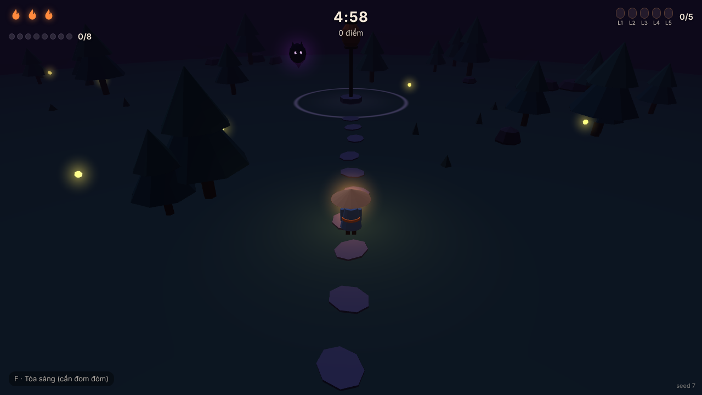

# Đảo Đèn Lồng

> **Video demo:** sẽ đính kèm ở Release `v1.0.0` (Phase 4).
> Phase hiện tại: **Phase 1 (PRD-0, Test Contract v1.0)**, tag `phase-1`.

Game 3D góc nhìn thứ ba. **Mây**, người giữ đèn nhỏ tuổi đội nón lá có treo đèn lồng, chạy khắp **Đảo Bến** gom đom đóm
để thắp lại **5 Đèn Lồng Lớn** trước bình minh, né **Bóng Mực** tím đen trong sương. Thắp hết đèn thì thắng, mất hết lửa
hoặc trời sáng mà chưa xong thì thua.

Game viết bằng JavaScript thuần: logic tất định dùng chung cho trình duyệt và chế độ headless, renderer WebGL tự viết.
**Không có thư viện ngoài, không asset tải về.**



## Cài đặt và chạy (3 lệnh)

Cần **Node.js ≥ 18** và trình duyệt có WebGL (Chrome, Firefox, Safari). Chạy trên macOS hoặc Linux.

```bash
git clone https://github.com/Long1806T/K5-L3A-DAY12-PHAMNHULONG-2A202603395-AI-SDLC.git
cd K5-L3A-DAY12-PHAMNHULONG-2A202603395-AI-SDLC
npm start            # mở http://localhost:5173 (nếu không tự mở, dán link vào trình duyệt)
```

`npm install` (`build_cmd` trong contract) không tải gì vì dự án không có dependency. Tham số `?seed=123` cố định seed;
`?scenario=scenarios/phase1/pulse.scenario.json` mở game bằng một file scenario của contract.

## Điều khiển

| Phím | Việc |
|---|---|
| `W A S D` | đi lại, theo hướng camera |
| `Space` | nhảy |
| `E` | nạp ánh sáng (đom đóm đang mang) vào Đèn Lồng Lớn gần nhất |
| `F` / `Shift` / chuột phải | tỏa sáng: xua Bóng Mực quanh mình |
| kéo chuột trái, `←` `→` | xoay camera; lăn chuột để zoom |
| `P` / `Esc` | tạm dừng |
| `R` / `Enter` | chơi lại (sau khi thắng/thua) |

## Luật chơi và cách tính điểm

Các con số lấy từ `game.contract.json`, cũng là file game đọc lúc chạy.

- **Đom đóm**: đi tới trong 1,2 m là nhặt tự động. Mang tối đa 8 con.
- **Đèn Lồng Lớn**: đứng trong 2,5 m, bấm `E` để nạp. Đèn cần 5 đom đóm; mang dư thì phần dư giữ lại. Đèn sáng thì đảo ấm dần lên.
- **Vùng an toàn**: Bóng Mực không vào được bán kính 4 m quanh **mọi** Đèn Lồng Lớn. Đứng trong vùng này không bị chạm.
- **Bóng Mực**: luôn đuổi theo (3,5 m/s, chậm hơn Mây 6 m/s). Bị chạm (0,9 m) thì mất 1 ngọn lửa, đánh rơi `floor(đang mang × 0,5)` đom đóm (chúng bay mất vào sương) và bất tử 1,5 s.
- **Tỏa sáng**: tốn 1 đom đóm. Mọi Bóng Mực trong 6 m bị choáng 3 s và bị đẩy lùi 4 m. Hồi chiêu 2 s.
- **Thời gian**: 5 phút. Hết giờ là thua (`dawn`). Có 3 ngọn lửa; hết lửa là thua (`no_flames`).
- **Điểm**: +10 mỗi đom đóm nhặt, +100 mỗi đèn thắp, +25 mỗi Bóng Mực bị choáng. Khi **thắng** cộng thêm 2 × số giây còn lại (làm tròn xuống) + 50 × số lửa còn lại.

Các giả định cho chỗ PRD-0 còn mơ hồ (vì sao chọn như trên) nằm ở [docs/notes/phase-1.md](docs/notes/phase-1.md#2-giả-định-cho-chỗ-prd-0-còn-mơ-hồ).

## Chế độ headless (Test Contract v1.0)

```bash
node src/headless.js --seed 1 --night 1 --ticks 600 --out out.jsonl \
  [--scenario scenarios/phase1/pulse.scenario.json] [--inputs scenarios/phase1/pulse.inputs.json] [--snapshot-every 10]
```

- 60 tick/giây cố định, không cần cửa sổ hay GPU. Một đêm 18 000 tick chạy khoảng 0,1 s.
- Ghi JSONL gồm snapshot, event và dòng `end` cuối cùng, đúng định dạng contract. Cùng seed, scenario và inputs luôn cho output giống hệt.
- Mã thoát: `0` khi chạy xong, `2` khi file scenario/inputs sai định dạng, `1` cho lỗi khác (thiếu tham số, night không có…). Thông báo lỗi ghi ra stderr.

## Test và bằng chứng

```bash
npm test                         # 48 test: luật chơi, CLI, mã thoát, tất định, chơi trọn đêm
sh scripts/verify.sh             # test + một lượt headless (cũng là lệnh của hook)
npm run proof -- --phase 1       # sinh lại docs/proof/phase-1/proof.md từ các lần chạy thật
node tools/capture.mjs           # (dev, cần Playwright + Chrome) chơi trong Chrome headless và chụp ảnh
```

- Bảng truy vết yêu cầu → bằng chứng: [docs/proof/phase-1/README.md](docs/proof/phase-1/README.md)
- Bằng chứng tự sinh: [docs/proof/phase-1/proof.md](docs/proof/phase-1/proof.md), ảnh trong [docs/proof/phase-1/screens/](docs/proof/phase-1/screens/)
- CI: `.github/workflows/ci.yml` chạy test trên Node 18/20/22 mỗi lần push.

## Cấu trúc

```text
game.contract.json      Test Contract: lệnh + tuning (game đọc trực tiếp file này)
src/core/               logic thuần, tất định (sim, rng, level, inputs, validate)
src/headless.js         CLI headless theo contract
src/web/                renderer WebGL, model low-poly, HUD, điều khiển
index.html              trang game
scenarios/phase1/       scenario + inputs mẫu (cả file lỗi trong bad/)
tests/                  node:test
tools/                  serve (server tĩnh), bot (autopilot), proof, capture
docs/notes/             yêu cầu, giả định, đánh giá từng phase, nhật ký dùng AI
docs/proof/phase-1/     bằng chứng Phase 1
docs/lab/               đề bài gốc của lab
AGENTS.md, CLAUDE.md, .claude/, .githooks/, scripts/   harness cho AI agent
```

## Sáng tạo của tôi

- **Đường đá dẫn lối** từ chỗ xuất phát tới từng Đèn Lồng Lớn, giúp định hướng trong đêm.
- **Đom đóm bay quanh Mây**: số con bay đúng bằng số đang mang. Đèn nhỏ trên nón sáng và lan xa hơn khi mang nhiều.
- **Đảo Bến** có bến gỗ, hai nhà chòi, rừng thông, biển mây bên dưới, trời sao và trăng.
- **Bóng Mực trồi lên từ sương** (1 s vô hại) khi tự sinh. Khi bị choáng chúng nhạt màu và có sao xoay trên đầu.

Phần lõi vẫn đúng: tất cả nằm trong `src/web/` (chỉ vẽ), trừ trạng thái `emerge`. `emerge` là giả định G11, chỉ áp dụng
cho Bóng Mực tự sinh; Bóng Mực trong scenario vào `chase` ngay như contract yêu cầu (test
`random_motes/shades false…`, `shades chase at shade_speed`). Ảnh: [screens/](docs/proof/phase-1/screens/).

## Ghi chép

- Phase 1: [docs/notes/phase-1.md](docs/notes/phase-1.md) (tiêu chí nghiệm thu, giả định, đánh giá)
- Nhật ký dùng AI (token, lỗi của AI, chỉnh harness): [docs/notes/ai-log.md](docs/notes/ai-log.md)
- [CHANGELOG.md](CHANGELOG.md) · [CREDITS.md](CREDITS.md) · [LICENSE](LICENSE)
