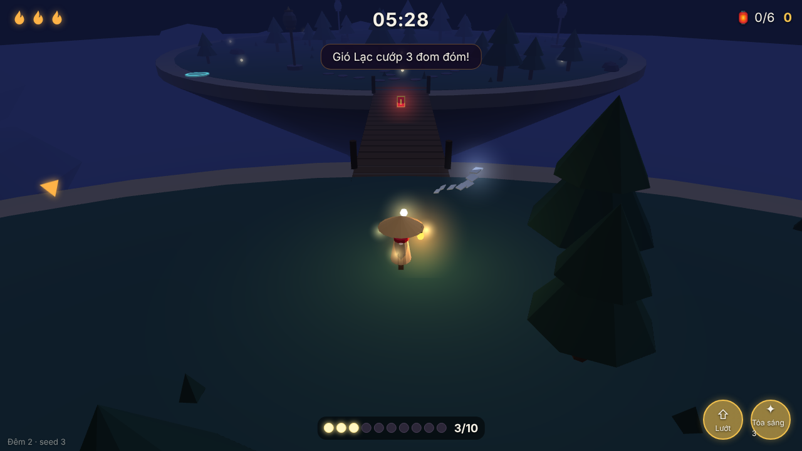

# Đảo Đèn Lồng

> **Video demo:** sẽ đính kèm ở Release `v1.0.0` (Phase 4).
> Phase hiện tại: **Phase 3 (Ticket-03 "Đèn cạn dầu", Test Contract v1.2)**.

Game 3D góc nhìn thứ ba qua **3 Đêm**: Đảo Bến, Đảo Cau, Đảo Chuông. **Mây** là người giữ đèn nhỏ tuổi, mặc áo kem, quàng
khăn đỏ, đội nón lá có treo đèn lồng. Mây gom đom đóm để thắp lại các **Đèn Lồng Lớn** trước bình minh, né **Bóng Mực**
tím đen và giữ đom đóm khỏi tay **Gió Lạc**.

Game viết bằng JavaScript thuần: logic tất định dùng chung cho trình duyệt và chế độ headless, renderer WebGL tự viết,
âm thanh tổng hợp bằng WebAudio. **Không có thư viện ngoài, không asset tải về.**



## Cài đặt và chạy (3 lệnh)

Cần **Node.js ≥ 18** và trình duyệt có WebGL (Chrome, Firefox, Safari). Chạy trên macOS hoặc Linux.

```bash
git clone https://github.com/Long1806T/K5-L3A-DAY12-PHAMNHULONG-2A202603395-AI-SDLC.git
cd K5-L3A-DAY12-PHAMNHULONG-2A202603395-AI-SDLC
npm start            # mở http://localhost:5173 (nếu không tự mở, dán link vào trình duyệt)
```

`npm install` (`build_cmd`) không tải gì vì dự án không có dependency.

## Điều khiển

| Phím | Việc |
|---|---|
| `W A S D` | đi lại, theo hướng camera |
| `Space` | nhảy |
| `Shift` | lướt (14 m/s trong 0,2 s, hồi 1,5 s) |
| `E` | nạp ánh sáng vào Đèn Lồng Lớn gần nhất, châm dầu đèn đang sáng, thắp lại đèn đã tắt |
| `F` / chuột phải | tỏa sáng: xua Bóng Mực, đuổi Gió Lạc (tốn 3 đom đóm) |
| kéo chuột trái, `←` `→` | xoay camera; lăn chuột để zoom |
| `Esc` / `P` | tạm dừng: Tiếp tục, Chơi lại Đêm, Cài đặt, Về menu |

## Luật chơi (số chuẩn của Ticket-02)

Các con số lấy từ `game.contract.json`, cũng là file game đọc lúc chạy.

- **Đom đóm**: tự nhặt khi cách ≤ 1 m (và chênh cao ≤ 1,5 m), mang tối đa 10. Lúc đầu có 20 con, cứ 4 s sinh thêm 1 con.
- **Đèn Lồng Lớn**: đứng trong 2 m, bấm `E` để nạp. Cần 10 đom đóm, nạp nhiều lần được. Đèn sáng có 100 dầu, cháy 1/s. Bấm `E` ở đèn đang sáng để **châm dầu** (+10 dầu mỗi đom đóm). Hết dầu đèn tắt; **thắp lại** chỉ cần 5 đom đóm. Đèn còn ≥ 30 dầu có vùng an toàn 6 m chặn Bóng Mực. Dưới 30 dầu thì đèn nhấp nháy và Bóng Mực tới **hút dầu**.
- **Sức chứa** bắt đầu từ 10, +2 sau mỗi lần thắp thành công, tối đa 20.
- **Bóng Mực**: xuất hiện từ giây thứ 5, đuổi khi Mây cách ≤ 12 m, bỏ đuổi khi > 18 m. Chạm Mây thì Mây mất 1 Ngọn Lửa, đom đóm rơi ra quanh Mây (8 s để nhặt lại), Mây bất tử 1,5 s.
- **Gió Lạc** (Đêm 2–3): bám theo khi Mây mang ≥ 5 đom đóm, cướp tối đa 3 con rồi bỏ chạy. Tỏa Sáng trúng thì nó bỏ chạy, hoặc nhả lại đồ đã cướp.
- **Bùa Gió** (Đêm 2–3): trong 10 s chạy 7,2 m/s và lướt không cần hồi chiêu.
- **Rơi khỏi đảo**: mất 1 Ngọn Lửa và toàn bộ đom đóm, 1 s sau hồi sinh ở điểm xuất phát.
- **Thắng**: còn sống tới bình minh (4 / 4,5 / 5 phút) với ít nhất 3/5, 4/6, 5/7 đèn đang sáng. **Thua**: hết 3 Ngọn Lửa, hoặc trời sáng mà thiếu đèn.
- **Điểm**: +5 mỗi đom đóm nạp hoặc châm, +100 thắp lần đầu, +40 thắp lại, +5 mỗi Bóng Mực trúng Tỏa Sáng (+15 nếu nó đang hút dầu). Khi thắng, mỗi đèn đang sáng được +50 + số dầu còn lại, mỗi Ngọn Lửa +50. Tổng điểm game là tổng các Đêm đã thắng.

Giả định cho chỗ ticket chưa nói: [phase-2.md](docs/notes/phase-2.md#3-giả-định-cho-chỗ-ticket-chưa-nói), [phase-3.md](docs/notes/phase-3.md#3-giả-định). Quyết định thiết kế: [ADR 0001](docs/adr/0001-lantern-fuel-and-dawn-win.md).

## Chế độ headless (Test Contract v1.2)

```bash
node src/headless.js --seed 1 --night 1|2|3 --ticks 600 --out out.jsonl \
  [--scenario scenarios/phase2/charm.scenario.json] [--inputs scenarios/phase2/charm.inputs.json] [--snapshot-every 10]
```

- 60 tick/giây cố định, không cần cửa sổ hay GPU. Một Đêm dài nhất (21 600 tick) chạy trong khoảng 0,5 s.
- Ghi JSONL gồm snapshot (v1.2), các sự kiện (kể cả `night_start` ở tick 0) và dòng `end` cuối cùng. Cùng seed, scenario và inputs luôn cho output giống hệt.
- Mã thoát: `0` khi chạy xong, `2` khi file scenario/inputs sai định dạng, `1` cho lỗi khác.

## Test và bằng chứng

```bash
npm test                         # 81 test: luật chuẩn, dầu/bình minh, mỗi tính năng một scenario qua CLI, bản đồ, tất định
sh scripts/verify.sh             # test + một lượt headless (cũng là lệnh của hook)
npm run proof -- --phase 3       # sinh lại docs/proof/phase-3/ từ các lần chạy thật
node tools/capture.mjs           # (dev, cần Playwright + Chrome) chơi trong Chrome headless, chụp ảnh, đếm âm thanh, đo FPS
```

- Bảng truy vết: [Phase 1](docs/proof/phase-1/README.md) · [Phase 2](docs/proof/phase-2/README.md) · [Phase 3](docs/proof/phase-3/README.md)
- CI: `.github/workflows/ci.yml` chạy test trên Node 18/20/22 mỗi lần push.

## Cấu trúc

```text
game.contract.json      Test Contract: lệnh + tuning (game đọc trực tiếp file này)
src/core/               logic thuần, tất định (sim, level/bản đồ, rules, rng, inputs, validate)
src/headless.js         CLI headless theo contract
src/web/                renderer WebGL, model low-poly, HUD, âm thanh, cài đặt, menu
index.html              trang game
scenarios/phase1|2/     scenario + inputs mẫu (cả file lỗi trong bad/)
tests/                  node:test
tools/                  serve (server tĩnh), bot (autopilot), proof, capture
docs/notes/             yêu cầu, giả định, đánh giá từng phase, nhật ký dùng AI
docs/proof/phase-N/     bằng chứng từng phase
AGENTS.md, CLAUDE.md, .claude/, .githooks/, scripts/   harness cho AI agent
```

## Sáng tạo của tôi

- **Đường đá dẫn lối** từ chỗ xuất phát tới từng Đèn Lồng Lớn trên cùng tầng.
- **Đom đóm bay quanh Mây**: số con bay đúng bằng số đang mang. Đèn trên nón sáng và lan xa hơn khi mang nhiều.
- **Đảo Bến** có bến gỗ và hai nhà chòi. Biển mây, trời sao và trăng hiện ở cả 3 Đêm.
- **Bóng Mực trồi lên từ sương** (trạng thái `spawning`). Khi bị choáng chúng đổi màu và có sao xoay trên đầu.
- **Gió Lạc** là một dải lụa uốn lượn theo hướng bay. Khi đang ôm đom đóm cướp được, nó sáng hơn.

Phần lõi vẫn đúng: tất cả chỉ nằm trong `src/web/`. Bộ test headless (81 test) không đổi khi bỏ phần hình ảnh.
Ảnh: [docs/proof/phase-2/screens/](docs/proof/phase-2/screens/).

## Ghi chép

- [Phase 1](docs/notes/phase-1.md) · [Phase 2](docs/notes/phase-2.md) · [Phase 3](docs/notes/phase-3.md) · [ADR 0001](docs/adr/0001-lantern-fuel-and-dawn-win.md): yêu cầu, giả định, quyết định, đánh giá
- Nhật ký dùng AI (token, lỗi của AI, chỉnh harness): [docs/notes/ai-log.md](docs/notes/ai-log.md)
- [CHANGELOG.md](CHANGELOG.md) · [CREDITS.md](CREDITS.md) · [LICENSE](LICENSE)
